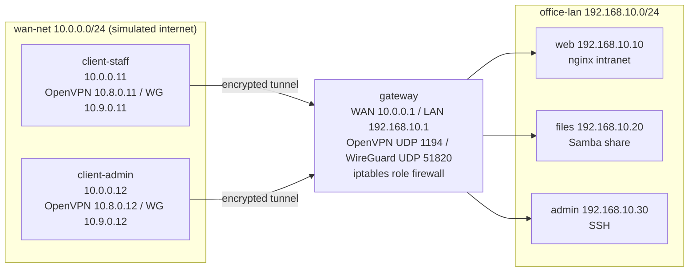

# Virtual Office Network Design using VPN (OpenVPN & WireGuard)

 -88171A)  

CS-3001 Computer Networks project, FAST NUCES Karachi. A fictional company ("Acme Corp") whose internal servers are reachable **only** through a VPN gateway. Built twice, with **OpenVPN** and **WireGuard**, with role-based access control, encryption verification by packet capture, security tests, and a performance comparison.

## Topology



Six VirtualBox VMs (Ubuntu Server 26.04). Plain routing, **no NAT**, so the gateway firewall sees each client's real tunnel IP.

## Features

| # | Feature | Implementation |
|---|---|---|
| 1 | Gateway & routing | Two interfaces, `ip_forward=1`, routes pushed to clients |
| 2 | OpenVPN | UDP 1194, tun, AES-256-GCM only, tls-crypt, TLS >= 1.2, DCO disabled, fixed IPs via `ccd` |
| 3 | WireGuard | UDP 51820, kernel module, AllowedIPs /32 per peer, keepalive 25 s |
| 4 | Keys & authentication | Easy-RSA CA (EC prime256v1) + CRL revocation; WireGuard Curve25519 key pairs + per-peer pre-shared keys |
| 5 | Encryption check | Packet captures: WAN unreadable, tunnel interface plaintext; ciphers confirmed |
| 6 | Role-based access | Staff: web (80) + files (445) only; admin: whole office LAN; everything else logged and dropped |
| 7 | Testing | ping, traceroute, nmap, unauthorised access, revoked certificate, unknown WireGuard key, peer removal, PSK mismatch |
| 8 | Comparison | iperf3 throughput, latency, connection time |

## Access matrix

| | web :80 | files :445 | admin :22 |
|---|---|---|---|
| Staff (10.8.0.11 / 10.9.0.11) | allowed | allowed | **dropped + logged** |
| Admin (10.8.0.12 / 10.9.0.12) | allowed | allowed | allowed |
| No VPN | unreachable | unreachable | unreachable |

## Results

| Metric | No VPN (1 hop) | OpenVPN | WireGuard |
|---|---|---|---|
| Throughput (iperf3, 5 x 10 s) | 4232.2 Mbit/s | 156.6 Mbit/s | **717.0 Mbit/s** |
| Latency (50 pings) | 1.026 ms | 2.853 ms | 2.713 ms |
| Connection time (5 runs) | - | 0.104 s | **0.073 s** |

WireGuard was about 4.6x faster in throughput and about 30% faster to connect; latency was practically equal at idle. The numbers come from six VMs on one laptop (i5-1235U, 8 GB RAM), so only the **relative** comparison is meaningful. OpenVPN ran in classic user-space mode (DCO disabled on purpose).

## Encryption evidence

| | OpenVPN | WireGuard |
|---|---|---|
| Data cipher | AES-256-GCM | ChaCha20-Poly1305 |
| Handshake | TLS 1.3 (TLS_AES_256_GCM_SHA384, X25519MLKEM768) | Noise_IKpsk2 (Curve25519, BLAKE2s) |
| WAN capture | `captures/openvpn_wan.pcap`: no readable content | `captures/wireguard_wan.pcap`: Handshake Initiation / Response / Transport Data, no readable content |
| Tunnel capture | `captures/openvpn_tun.pcap`: plaintext HTTP | `captures/wireguard_tun.pcap`: plaintext HTTP |

## Repository structure

```
configs/openvpn/     server.conf, client profiles (keys redacted)
configs/wireguard/   wg0.conf for gateway and clients (keys redacted)
configs/firewall/    firewall.sh (role rules) and saved iptables.rules
configs/netplan/     static addressing for all six VMs
captures/            pcap files for Wireshark
screenshots/         72 numbered evidence screenshots (NNstepX_name.png)
docs/                report and proposal
```

## Reproducing (summary)

1. Create six Ubuntu Server VMs and three VirtualBox networks: NAT (management), `wan-net`, `office-lan`. Apply `configs/netplan/`.
2. Gateway: `sysctl net.ipv4.ip_forward=1`, install `openvpn easy-rsa wireguard-tools iptables`.
3. Build the CA with Easy-RSA (server and client certificates, `ta.key`, CRL), deploy `configs/openvpn/server.conf`, add `ccd` entries for fixed client IPs.
4. Generate WireGuard keys on each host (`wg genkey | tee private.key | wg pubkey > public.key`) and a PSK per peer (`wg genpsk`), fill in the redacted `wg0.conf` files, then `wg-quick up wg0`.
5. Apply `configs/firewall/firewall.sh` on the gateway and save the rules.
6. Run only one VPN at a time for tests and measurements.

## Security note

All private keys, `ta.key` and pre-shared keys have been **removed** (redacted). Public keys, private IP addresses and the Samba password shown in screenshots are **lab-only** values. This is a teaching lab, not a production setup: see the shortcuts and limitations in the report (e.g. CA without a passphrase on the gateway, OpenVPN running as root, management interface open).

## Authors

- **Muhammad Musawar Ali Shah** (24P-0619): design, implementation, testing, report
- Muhammad Anwar (24P-0656): project partner named on the original proposal

## References

1. J. F. Kurose and K. W. Ross, *Computer Networking: A Top-Down Approach*, 8th ed., Pearson, 2021.
2. J. A. Donenfeld, "WireGuard: Next Generation Kernel Network Tunnel," NDSS 2017.
3. OpenVPN and Easy-RSA documentation, https://community.openvpn.net
4. WireGuard documentation, https://www.wireguard.com
5. Wireshark User's Guide, https://www.wireshark.org/docs
6. iperf3 documentation, https://iperf.fr

## License

[MIT](LICENSE)
